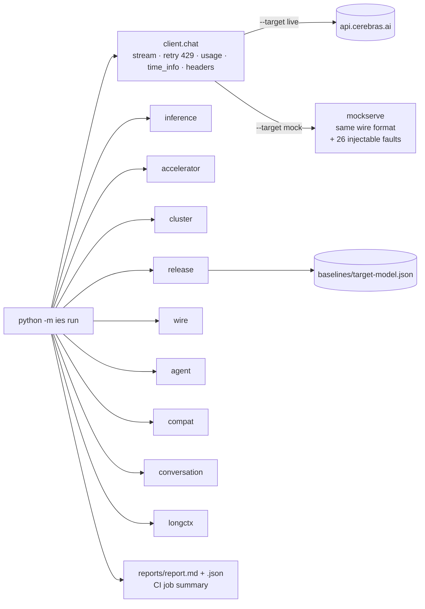

# inference-endpoint-scenarios

One harness, nine scenarios (Inference, Accelerator, Cluster, Release, Wire, Agent, Compat, Conversation, Long context), run **live against the Cerebras Inference API** (`api.cerebras.ai`, Chat Completions via `cerebras_cloud_sdk`) or against a wire-compatible local mock with fault injection.

Each scenario looks at the same endpoint and asks a different question:

| Scenario | What it proves from the API | Example regression it catches |
|---|---|---|
| **Inference** (`inference`) | The client contract: usage arithmetic, stream usage, `max_completion_tokens`, stop sequences, strict JSON schema, tool calls (incl. streamed argument reassembly), `reasoning_effort=none`, error codes 401/404/400 | `total_tokens` ≠ prompt + completion (billing), stream drops usage (metering) |
| **Accelerator** (`accelerator`) | Hardware behaviour as the API exposes it: server decode tok/s (`time_info.completion_time`), prefill rate vs prompt length, TTFT split into queue / prefill / network, prompt-cache effect, T=0 reproducibility, logprob drift | decode 2,000 → 200 tok/s (kernel regression); same tokens but logprobs drift (numerics) |
| **Cluster** (`cluster`) | Concurrency sweep 1→4→8: latency inflation, error rate after retries, 429 absorption (`retry-after`, then jittered backoff), rate-limit headroom headers, request isolation | latency grows with in-flight load; a request receives *another* request's answer |
| **Release** (`release`) | Golden suite with checkable answers, repeated at T=0, diffed against a recorded baseline with `system_fingerprint` → **GO / NO-GO / INCONCLUSIVE** | arithmetic regression shipped with a new backend build → NO-GO; flaky case → INCONCLUSIVE |
| **Wire** (`wire`) | Compressed request bodies (`application/vnd.msgpack`, `Content-Encoding: gzip`): all four encodings reach the server as the same request (same `prompt_tokens`, same answer); bytes saved per prompt size; TTFT json vs msgpack+gzip on a warm-cache 16K-token prompt | a decompression buffer that silently truncates the prompt (200 OK, fewer `prompt_tokens`); a proxy that drops `Content-Encoding` |
| **Agent** (`agent`) | A two-round tool-calling loop (parallel `get_weather` → `convert_c_to_f` → answer): task success, every tool argument schema-valid, end-to-end loop latency and per-turn TTFT, whether the model actually used the tools | agent never stops calling tools; ignores tool results; emits truncated JSON arguments |
| **Compat** (`compat`) | The same requests through the **OpenAI Python SDK** (`base_url=…/v1`, how Braintrust, Weave and LangChain call Cerebras) and through `cerebras_cloud_sdk`: same usage, streamed usage with `include_usage`, `time_info` still readable via `model_extra`, `max_tokens` honoured like `max_completion_tokens`, tool calls, strict JSON, `openai.*Error` types for 404 / 401 / 400 | server ignores `max_tokens`, the spelling most OpenAI-SDK code still sends (401 tokens back for a limit of 12) |
| **Conversation** (`conversation`) | 8-turn chat with one `prompt_cache_key`: a codename from turn 1 recalled in turn 8; `cached_tokens` grows turn over turn; turns 2-8 pay prefill only for new messages (uncached share ~5%, not 100%) | gateway keeps only the last 4 messages (fact forgotten, 200 OK); prompt cache never hits |
| **Long context** (`longctx`) | Needle recall over a (length × depth) grid up to 32K tokens; `prompt_tokens` must track the haystack size; ReadAgent-style gist chain (8 page summaries → answer from summaries), timed end to end | context silently clipped at ~8K tokens (needles past it missed, and `prompt_tokens` gives it away even when the needle survives); a summary drops the number the final answer needs |



## Run it live

```bash
python3 -m venv .venv && .venv/bin/pip install -r requirements.txt
cp .env.example .env            # put your key in CEREBRAS_API_KEY (cloud.cerebras.ai → API Keys)
.venv/bin/python -m ies chat "Why is fast inference important?"
.venv/bin/python -m ies run                         # all nine scenarios, ~130 requests
.venv/bin/python -m ies run -w release --update-baseline   # record the live release baseline once
.venv/bin/python -m ies run -w accelerator,cluster
```

`chat` is the quickstart done properly: streamed, 429-retried, and printed with usage, cost, and the server's own timing:

```
[USAGE] prompt=15 completion=212 cached=0 cost=$0.000331
[TIME] ttft=… wall=… | server queue=… prefill=… decode=… (… tok/s) fp=…
```

The default model is `qwen-3.8-27b` (300 RPM on the free tier) with `reasoning_effort="none"`, so the tests measure answers, not hidden reasoning. `--model gpt-oss-120b` works too, but its free-tier limit is 5 RPM, so the `cluster` sweep there measures throttling, not the cluster. A hard request budget per run (`max_requests` in `slo.json`) stops a buggy sweep from burning quota. Wire's 12K/16K-token prompts and Long context's haystacks (up to 24K live) dominate token use: ~300K prompt tokens per full run, much of it prompt-cache hits. That's under $0.35 at list price even with no cache hits.

## Offline (CI, no key)

```bash
.venv/bin/python -m pytest                                    # 50 tests, ~65s
.venv/bin/python -m ies run --target mock                   # healthy: all workflows pass
.venv/bin/python -m ies run --target mock --faults slow_decode,crosstalk
```

The mock speaks the real wire format (SSE chunks, final usage + `time_info` chunk, `system_fingerprint`, `x-ratelimit-*` headers, SSE error events, error bodies), so the same client code runs against both. `tests/test_faults.py` pins **which check goes red for which fault**, so a detector can't silently stop working:

| Fault | Caught by |
|---|---|
| `slow_ttft` | accelerator.ttft |
| `slow_decode` | accelerator.decode_throughput |
| `usage_drift` | inference.usage_accounting |
| `stream_no_usage` | inference.stream_usage_parity, accelerator.decode_throughput |
| `ignore_max_tokens` | inference.max_tokens_length |
| `midstream_error` | inference.stream_usage_parity, accelerator.decode_throughput, accelerator.ttft (raises, never truncates silently) |
| `nondeterministic` | accelerator.determinism |
| `logprob_noise` | accelerator.logprob_stability (argmax unchanged; only numerics see it) |
| `contention` | cluster.concurrency_latency |
| `crosstalk` | cluster.request_isolation |
| `rate_limit_light` | nothing: retries absorb it (asserted) |
| `rate_limit_storm` | cluster.error_rate, cluster.retry_absorption |
| `regress_math` + `fingerprint_v2` | release → **NO-GO**, names the regressed cases and the fingerprint change |
| `flaky_answers` | release → **INCONCLUSIVE**, not NO-GO |
| `fingerprint_v2` alone | release → GO with a warning |
| `gzip_ignored` | wire.wire_equivalence, wire.wire_ttft (400) |
| `msgpack_as_json` | wire.wire_equivalence, wire.wire_ttft (400) |
| `decompress_truncation` | wire.wire_equivalence: 200 OK but `prompt_tokens` 12,364 (json) vs 5,765 (gzip); only a cross-encoding comparison sees it |
| `bad_tool_args` | agent.agent_tool_args (the model recovers after the error result, so task success alone would miss it) |
| `agent_loop_stall` | agent.agent_task_success, agent.agent_loop_latency |
| `ignore_tool_results` | agent.agent_task_success (`Paris=18F`: Celsius passed off as Fahrenheit) |
| `max_tokens_alias_ignored` | compat.compat_max_tokens |
| `history_truncated` | conversation.conversation_recall |
| `cache_miss` | conversation.conversation_cache_growth, conversation.conversation_prefill_flat (uncached share 5% → 100%) |
| `context_truncated` | longctx.needle_recall (32K misses), longctx.context_accounting (`prompt_tokens` 8K for a 16K/32K haystack) |
| `lossy_gist` | longctx.gist_chain |

## CI

`.github/workflows/ci.yml`:
- **mock** (every push / PR): tests, then the full harness healthy, then a fault run that must fail.
- **sdk-matrix** (every push / PR): the full suite against `cerebras_cloud_sdk` 1.59.0, 1.67.0, 1.91.0, and the latest PyPI release (canary, doesn't block). See below.
- **live** (nightly + manual dispatch): the full harness against `api.cerebras.ai` using the `CEREBRAS_API_KEY` repo secret, report posted to the job summary. It skips cleanly if the secret isn't set.

## SDK matrix: what it found

Qualifying the client SDK is part of a release too. Running the suite across `cerebras_cloud_sdk` versions found:

| SDK | Result |
|---|---|
| 1.35.0 | no `reasoning_effort` parameter; no `delta.reasoning` |
| 1.50.1 | `usage.completion_tokens_details` comes back as a plain dict, so `.reasoning_tokens` raises `AttributeError` |
| 1.59.0, 1.67.0 | pass, once `prompt_cache_key` goes through `extra_body` (the typed parameter only exists in newer SDKs) |
| 1.91.0 | pass |

So the harness declares a minimum (`MIN_SDK = 1.59.0` in `ies/client.py`) and refuses older SDKs with an upgrade message instead of a confusing `AttributeError` mid-run, and it sends newer API parameters through `extra_body`.

## Built from Cerebras's own examples

- **Wire** follows [cerebras/inference-examples/payload-compression](https://github.com/cerebras/inference-examples/tree/main/payload-compression): same encodings, same warm-cache method. It adds what a test needs: every encoding must produce the *same request* on the server, not just a faster one.
- **Agent** is the shape of the agentic workflow examples in that repo (LangChain / LlamaIndex / multi-agent), reduced to a deterministic task with checkable answers.
- **Compat** follows the Braintrust and W&B Weave examples, which call Cerebras through the OpenAI client.
- **Conversation** is [conversational-memory-langchain](https://github.com/cerebras/inference-examples/tree/main/conversational-memory-langchain) as a test: history must reach the model, and the cache must make it cheap.
- **Long context**'s gist chain is the [gist / ReadAgent](https://github.com/cerebras/inference-examples/tree/main/gist) workflow reduced to a checkable task.
- **SDK matrix** targets [cerebras/cerebras-cloud-sdk-python](https://github.com/cerebras/cerebras-cloud-sdk-python) releases.

## Where this stops

- The API hides hardware. "Accelerator" here means hardware effects **as observed through the API** (server-side decode/prefill timing, numerics reproducibility), not on-device kernel or firmware testing.
- The cluster sweep is small by design (≤ 8 concurrent) to stay inside free-tier limits and respect a shared service. It measures the shape of the latency curve, not capacity limits.
- Live thresholds in `slo.json` are provisional until calibrated from repeated live runs. Seed determinism and prompt caching are reported but not gated on live, because the API documents both as best-effort.
- The golden suite is 8 cases with exact answers: a release smoke gate, not a model eval.
- The mock simulates uplink bandwidth (4 MB/s) so compression shows a TTFT effect offline; the live wire TTFT delta depends on your network and is reported, not gated.
- Not covered from inference-examples: the RAG demos (they need Pinecone / Weaviate; Long context tests answering from supplied text instead), LLM-as-judge evals (a judge model makes the gate non-deterministic), and the Streamlit UIs.
- CSL kernel examples ([cerebras/sdk-examples](https://github.com/cerebras/sdk-examples)) need the Cerebras SDK and fabric simulator, so they are out of scope here.

See [docs/STRATEGY.md](docs/STRATEGY.md) for why each signal gates or doesn't.
