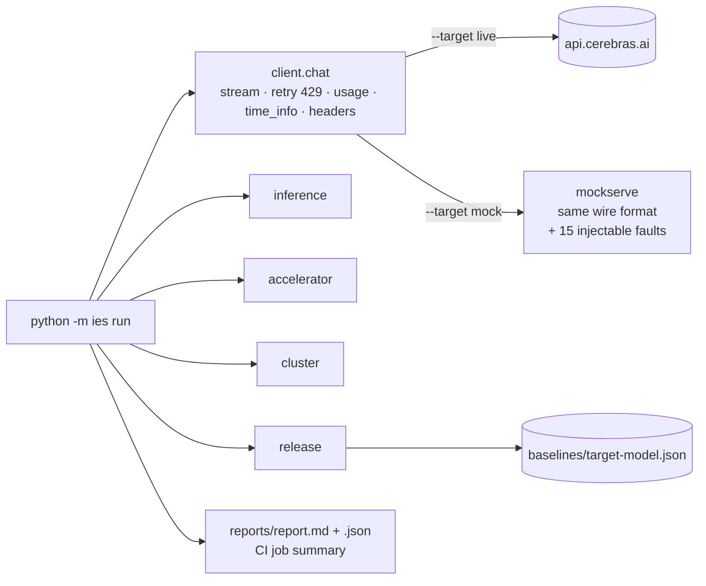

# inference-endpoint-scenarios

One harness, four scenarios (Inference, Accelerator, Cluster, Release), run **live against the Cerebras Inference API** (`api.cerebras.ai`, Chat Completions via `cerebras_cloud_sdk`) or against a wire-compatible local mock with fault injection.

Each scenario looks at the same endpoint and asks a different question:

| Scenario | What it proves from the API | Example regression it catches |
|---|---|---|
| **Inference** (`inference`) | The client contract: usage arithmetic, stream usage, `max_completion_tokens`, stop sequences, strict JSON schema, tool calls (incl. streamed argument reassembly), `reasoning_effort=none`, error codes 401/404/400 | `total_tokens` ≠ prompt + completion (billing), stream drops usage (metering) |
| **Accelerator** (`accelerator`) | Hardware behaviour as the API exposes it: server decode tok/s (`time_info.completion_time`), prefill rate vs prompt length, TTFT split into queue / prefill / network, prompt-cache effect, T=0 reproducibility, logprob drift | decode 2,000 → 200 tok/s (kernel regression); same tokens but logprobs drift (numerics) |
| **Cluster** (`cluster`) | Concurrency sweep 1→4→8: latency inflation, error rate after retries, 429 absorption (`retry-after`, then jittered backoff), rate-limit headroom headers, request isolation | latency grows with in-flight load; a request receives *another* request's answer |
| **Release** (`release`) | Golden suite with checkable answers, repeated at T=0, diffed against a recorded baseline with `system_fingerprint` → **GO / NO-GO / INCONCLUSIVE** | arithmetic regression shipped with a new backend build → NO-GO; flaky case → INCONCLUSIVE |



## Run it live

```bash
python3 -m venv .venv && .venv/bin/pip install -r requirements.txt
cp .env.example .env            # put your key in CEREBRAS_API_KEY (cloud.cerebras.ai → API Keys)
.venv/bin/python -m ies chat "Why is fast inference important?"
.venv/bin/python -m ies run                         # all four scenarios, ~80 small requests
.venv/bin/python -m ies run -w release --update-baseline   # record the live release baseline once
.venv/bin/python -m ies run -w accelerator,cluster
```

`chat` is the quickstart done properly: streamed, 429-retried, and printed with usage, cost, and the server's own timing:

```
[USAGE] prompt=15 completion=212 cached=0 cost=$0.000331
[TIME] ttft=… wall=… | server queue=… prefill=… decode=… (… tok/s) fp=…
```

The default model is `qwen-3.8-27b` (300 RPM on the free tier) with `reasoning_effort="none"`, so the tests measure answers, not hidden reasoning. `--model gpt-oss-120b` works too, but its free-tier limit is 5 RPM, so the `cluster` sweep there measures throttling, not the cluster. A hard request budget per run (`max_requests` in `slo.json`) stops a buggy sweep from burning quota.

## Offline (CI, no key)

```bash
.venv/bin/python -m pytest                                    # 30 tests, ~40s
.venv/bin/python -m ies run --target mock                   # healthy: all workflows pass
.venv/bin/python -m ies run --target mock --faults slow_decode,crosstalk
```

The mock speaks the real wire format (SSE chunks, final usage + `time_info` chunk, `system_fingerprint`, `x-ratelimit-*` headers, SSE error events, error bodies), so the same client code runs against both. `tests/test_faults.py` pins **which check goes red for which fault**, so a detector can't silently stop working:

| Fault | Caught by |
|---|---|
| `slow_ttft` | accelerator.ttft |
| `slow_decode` | accelerator.decode_throughput |
| `usage_drift` | inference.usage_accounting |
| `stream_no_usage` | inference.stream_usage_parity, accelerator.decode_throughput |
| `ignore_max_tokens` | inference.max_tokens_length |
| `midstream_error` | inference.stream_usage_parity, accelerator.decode_throughput, accelerator.ttft (raises, never truncates silently) |
| `nondeterministic` | accelerator.determinism |
| `logprob_noise` | accelerator.logprob_stability (argmax unchanged; only numerics see it) |
| `contention` | cluster.concurrency_latency |
| `crosstalk` | cluster.request_isolation |
| `rate_limit_light` | nothing: retries absorb it (asserted) |
| `rate_limit_storm` | cluster.error_rate, cluster.retry_absorption |
| `regress_math` + `fingerprint_v2` | release → **NO-GO**, names the regressed cases and the fingerprint change |
| `flaky_answers` | release → **INCONCLUSIVE**, not NO-GO |
| `fingerprint_v2` alone | release → GO with a warning |

## CI

`.github/workflows/ci.yml`:
- **mock** (every push / PR): tests, then the full harness healthy, then a fault run that must fail.
- **live** (nightly + manual dispatch): the full harness against `api.cerebras.ai` using the `CEREBRAS_API_KEY` repo secret, report posted to the job summary. It skips cleanly if the secret isn't set.

## Where this stops

- The API hides hardware. "Accelerator" here means hardware effects **as observed through the API** (server-side decode/prefill timing, numerics reproducibility), not on-device kernel or firmware testing.
- The cluster sweep is small by design (≤ 8 concurrent) to stay inside free-tier limits and respect a shared service. It measures the shape of the latency curve, not capacity limits.
- Live thresholds in `slo.json` are provisional until calibrated from repeated live runs. Seed determinism and prompt caching are reported but not gated on live, because the API documents both as best-effort.
- The golden suite is 8 cases with exact answers: a release smoke gate, not a model eval.

See [docs/STRATEGY.md](docs/STRATEGY.md) for why each signal gates or doesn't.
